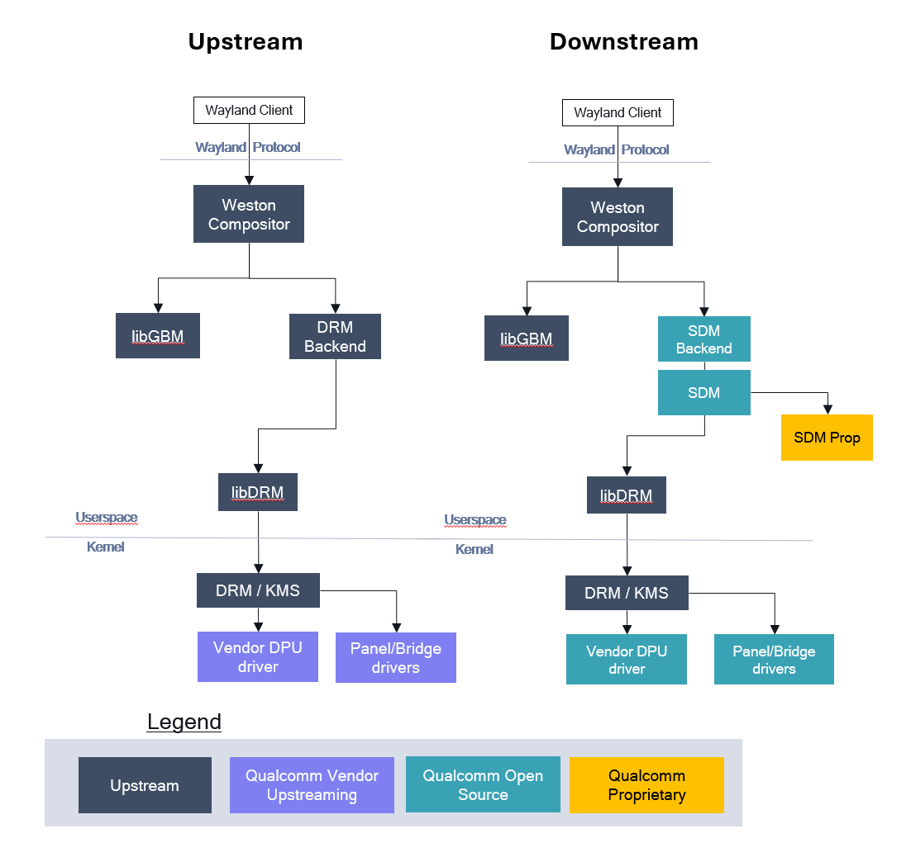

# SDM 2.0 Migration - Complete

## Architecture Overview

This diagram contrasts the standard **Upstream** display pipeline with Qualcomm's **Downstream** SDM-based display pipeline:

- **Upstream Pipeline**: The Weston Compositor interacts with standard `libGBM` and the `DRM Backend`, which goes through standard `libDRM` to the kernel-space `DRM/KMS` subsystem.
- **Downstream Pipeline (SDM)**: The Weston Compositor utilizes Qualcomm's `SDM Backend` and `SDM` layers (incorporating proprietary `SDM Prop` components and Qualcomm Open Source services) to perform composition, which then communicates with the kernel-space vendor DPU/panel drivers via `libDRM`.

---

## SDM 1.0 to SDM 2.0 API Replacement

### Core Interfaces

| SDM 1.0 API | SDM 2.0 API |
|-------------|-------------|
| `CoreInterface::CreateDisplay()` | `SDMDisplayLifeCycleIntf::CreateDisplay()` |
| `DisplayInterface::Prepare()` | `SDMDisplayDrawCycleIntf::CommitOrPrepare()` |
| `DisplayInterface::Commit()` | `SDMDisplayDrawCycleIntf::PresentDisplay()` |
| `DisplayInterface::SetDisplayState()` | `SDMDisplayLifeCycleIntf::SetDisplayState()` |
| `DisplayInterface::SetVSyncState()` | `SDMDisplayDrawCycleIntf::SetVsyncEnabled()` |
| `DisplayInterface::GetDisplayAttributes()` | `SDMDisplayCapsIntf::GetDisplayConfig()` |
| `DisplayInterface::SetPanelBrightness()` | `SDMDisplaySettingsIntf::SetPanelBrightness()` |
| `DisplayInterface::GetPanelBrightness()` | `SDMDisplaySettingsIntf::GetPanelBrightness()` |
| `DisplayInterface::MinHdcpEncryptionLevelChanged()` | `SDMDisplayDrawCycleIntf::MinHdcpEncryptionLevelChanged()` |

### Layer Management

| SDM 1.0 API | SDM 2.0 API |
|-------------|-------------|
| `LayerStack` structure with `Layer*` pointers | `std::vector<int64_t> layer_ids_` |
| Manual `Layer` object allocation | `SDMDisplayLayerBuilderIntf::CreateLayer()` |
| Manual `Layer` object deallocation | `SDMDisplayLayerBuilderIntf::DestroyLayer()` |
| Direct `Layer` field assignment | `SDMDisplayLayerBuilderIntf::SetLayerBuffer()`, `SetLayerSourceCrop()`, `SetLayerDisplayFrame()`, `SetLayerVisibleRegion()`, `SetLayerSurfaceDamage()`, `SetLayerTransform()`, `SetLayerBlendMode()`, `SetLayerPlaneAlpha()`, `SetLayerType()`, `SetLayerFlag()`, `SetLayerCompositionType()` |
| `layer->composition` field access | `SDMDisplayLayerBuilderIntf::GetDeviceSelectedCompositionType()` |
| `layer->input_buffer.color_metadata` field access | `SDMDisplayLayerBuilderIntf::GetLayerColorMetadata()` |
| `layer->input_buffer.release_fence_fd` field access | `SDMDisplayDrawCycleIntf::GetReleaseFences()` |
| `layer_stack_.retire_fence` field | `retire_fence_` member variable |
| `layer_stack_.flags.hdr_present` field | `hdr_present_` member variable |

### Interface Replacement

| SDM 1.0 | SDM 2.0 |
|---------|---------|
| `CoreInterface*` (single interface) | `SDMDisplayLifeCycleIntf*`, `SDMDisplayDrawCycleIntf*`, `SDMDisplayLayerBuilderIntf*`, `SDMDisplayCapsIntf*`, `SDMDisplaySettingsIntf*`, `SDMDisplaySideBandIntf*`, `SDMDisplayAiqeIntf*` |
| `DisplayInterface*` (single interface) | Split into 7 specialized SDM 2.0 interfaces above |

---

## Files Modified

- **backend-sdm-2.0.1/README.md** (Added)
- **backend-sdm-2.0.1/meson.build** (Modified - Added libsdmclient dependency)
- **backend-sdm-2.0.1/sdm-service/sdm_color_mode_intf.h** (Modified)
- **backend-sdm-2.0.1/sdm-service/sdm_color_mode_intf_impl.h** (Modified)
- **backend-sdm-2.0.1/sdm-service/sdm_color_mode_intf_impl.cpp** (Modified)
- **backend-sdm-2.0.1/sdm-service/sdm_display.h** (Modified)
- **backend-sdm-2.0.1/sdm-service/sdm_display.cpp** (Modified)
- **backend-sdm-2.0.1/sdm-service/sdm_display_connect.h** (Modified)
- **backend-sdm-2.0.1/sdm-service/sdm_display_connect.cpp** (Modified)

---

## Status

✅ **Migration Complete** - All SDM 1.0 APIs replaced with SDM 2.0 APIs

## License

This project is licensed under the [LICENSE](LICENSE).
